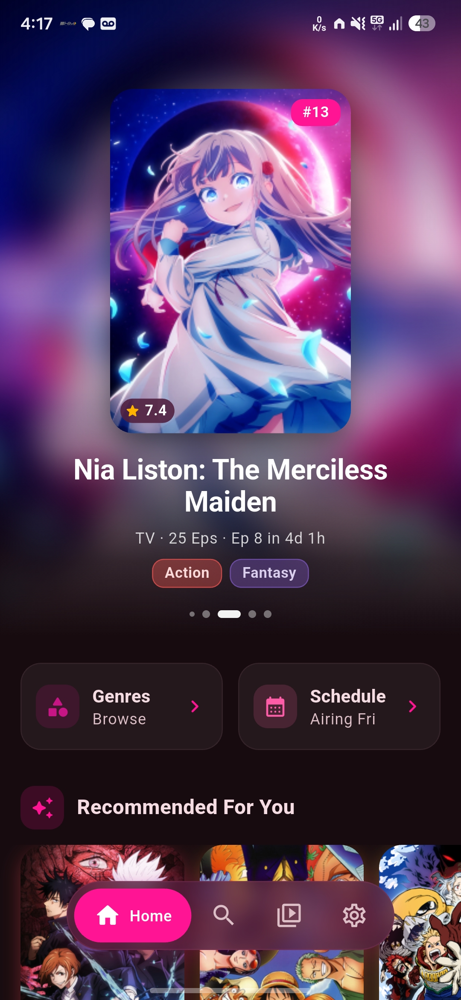
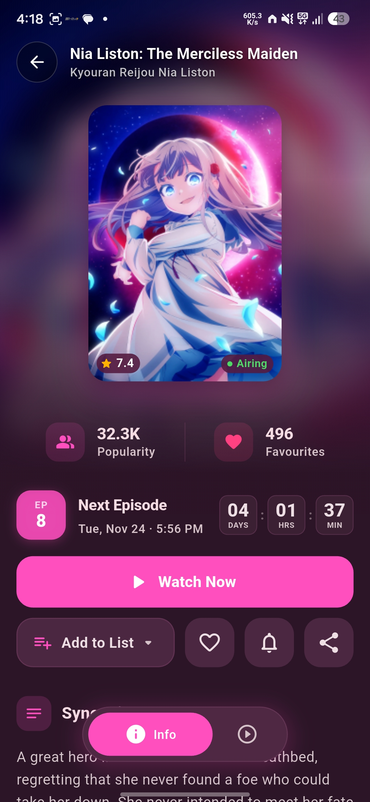
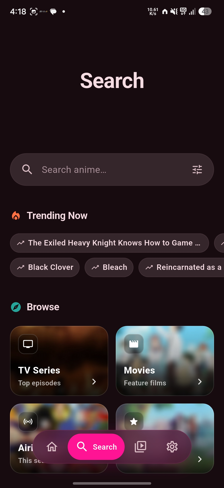
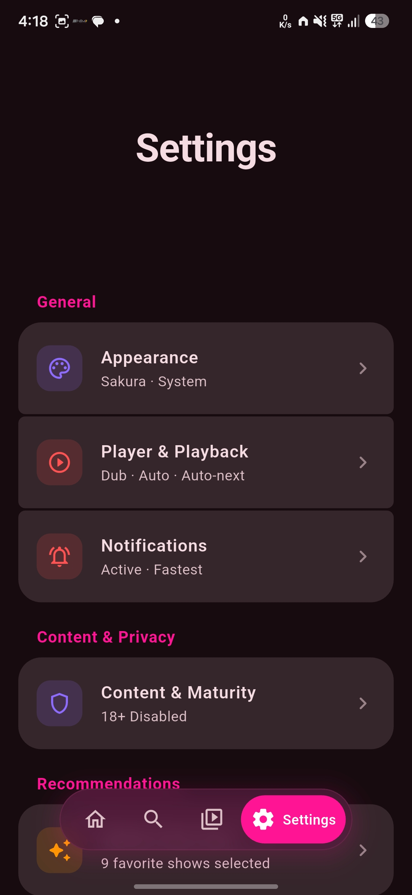

  <picture>
    <source media="(prefers-color-scheme: dark)" srcset="screenshots/logo_dark.jpg">
    <source media="(prefers-color-scheme: light)" srcset="screenshots/logo_light.jpg">
    
  </picture>

<h1 align="center">Aniways</h1>

  A modern, elegant, and extensible anime tracking, schedule, and discovery application built with Flutter.

  
  
  
  

---

## Screenshots

|                                          Home & Discovery                                          |                                              Anime Details                                               |                                         Search & Filters                                         |                                        Settings & Extensions                                         |
| :------------------------------------------------------------------------------------------------: | :------------------------------------------------------------------------------------------------------: | :----------------------------------------------------------------------------------------------: | :--------------------------------------------------------------------------------------------------: |
|  |  |  |  |

---

## Features

- [x] **Metadata & Discovery**: Explore seasonal charts, trending releases, voice actors, and synopses powered by AniList.
- [x] **Local Library & Progress**: Track your watch status, episode watch progress, and saved favorites completely offline.
- [x] **Airing Schedules**: Live countdowns, seasonal anime charts, and episode release notifications.
- [x] **One UI Design**: Bottom-oriented controls designed for comfortable one-handed reachability.
- [x] **Dynamic Theming & AMOLED**: Automatic Material 3 color extraction from poster art & pure black mode.
- [x] **Adaptive Layouts**: Responsive navigation rail and dual-pane views for tablets.
- [x] **Gesture Video Player**: VLC-style vertical swipes for brightness/volume, double-tap seek, and pinch-to-zoom.
- [x] **Quality & Multi-Server**: Quick server switching, quality selection up to 1080p, and variable playback speeds.
- [x] **Customizable Subtitles**: Full soft subtitle support with adjustable fonts, colors, opacity, and timing offsets.
- [x] **Smart Playback**: Automatic episode progress tracking, auto-next episode, and skip intro/outro markers.
- [x] **Decentralized Extensions**: Modular community extensions for video source resolution.
- [x] **Backups**: Portable `.anw` backup export and restore.
- [x] **In-App Updater**: Direct GitHub Releases update checks with seamless background installation.

### Upcoming

- [ ] **Watching Stats**: In-depth viewing statistics and time-spent analytics.
- [ ] **Multi-Platform Support**: Native support for Windows, Linux, and macOS.
- [ ] **Downloads**: Download episodes for offline viewing.
- [ ] *And more planned for future updates...*

---

## Installation

Download the latest stable APK from GitHub Releases:

- **[Download Latest Release](https://github.com/aniwaysofficial/aniways/releases)**

**Requirements**: Android 7.0 (API level 24) or higher.

---

## Contributing

Contributions, bug reports, and feature requests are welcome!

1. Fork the repository.
2. Create your feature branch (`git checkout -b feat/my-feature`).
3. Commit your changes (`git commit -m "feat: add my feature"`).
4. Push to your branch (`git push origin feat/my-feature`).
5. Open a Pull Request.

---

## Disclaimer

Aniways is a free, open-source media tracking and player client powered by the AniList API.

- **No Media Hosted**: Aniways does not host, provide, store, cache, upload, or distribute any media files, video streams, or copyrighted material.
- **Decentralized Architecture**: Out of the box, Aniways contains no video scrapers or content streams. All stream resolution and playback functionality is provided through modular third-party extensions installed voluntarily by the user.
- **Third-Party Sources**: The developers and maintainers of Aniways have no affiliation with any third-party video hosts, stream providers, or external servers.
- **User Responsibility**: Users are solely responsible for ensuring that their use of extensions and content access adheres to all applicable local laws, regulations, and third-party terms of service.

---

## License

This project is licensed under the [GNU General Public License v3.0 (GPL-3.0)](LICENSE).
